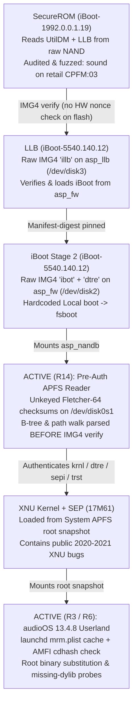

# homepod-untethered

Poorly organized research notes, reverse-engineering findings, and hardware experiments toward **untethered unsigned code execution** on the 1st-generation Apple HomePod (**A1639** / `AudioAccessory1,1` / `b238a`, Apple A8 `T7000`).

Largely a dump of my running notes. Still looking for help / contributions!

Today, running custom software (such as Linux / Nicotine or an SSH ramdisk) on a 1st-gen HomePod is **tethered**: every cold power-up requires a USB host to trigger `checkm8` in SecureROM DFU. This repository documents the ongoing campaign to close the persistence gap across a cold boot with **no host attached**.

> [!IMPORTANT]
> **How to read this repository:** [`FINDINGS.md`](./FINDINGS.md) is an append-only, chronological lab notebook. Several apparent breakthroughs recorded mid-session were later **disproven and retracted** once tighter experimental controls were built (for example, `R5`, `R9`, `R12`, and `R13.1`). **Read from the bottom up**, and check [`TODO.md`](./TODO.md) or the summary tables below before building on an earlier entry.

---

## Current Status

* **Full cold-boot untether:** **Open** (not yet achieved).
* **Target signed baseline:** **audioOS 13.4.8 (`17M61`)** — `iBoot-5540.140.12` (July 2020), which Apple's TSS server **still signs** for retail A1639 units and which predates iOS/audioOS 14+ memory-safety mitigations.
* **Persistent userland root execution (`R3`):** **Proven on hardware.** Any trust-cached Apple binary placed at a cached `RunAtLoad` daemon path inside the System APFS snapshot executes **as `root` on every cold boot** with no integrity violation.
* **Primary boot-chain target (`R14`):** **Active audit.** `iBoot-5540.140.12` mounts and walks the System APFS container on `disk1s1` *before* authenticating any IMG4 payload, protected only by unkeyed **Fletcher-64** checksums (`0x162c8`). B-tree node/lookup code (`0x14ae8..0x1526c`) and path-walking routines (`0x15a18`) have been located and are currently under static and hardware audit.

---

## Target Platform & Cold-Boot Architecture

| Property | Value |
| :--- | :--- |
| **Model / Board** | HomePod 1st Gen (`A1639` / `AudioAccessory1,1` / `b238aap`, MLB `820-00960-04`) |
| **SoC / Fuse Config** | Apple A8 (`t7000si`, `CPID:7000`, `CPRV:11`, `BDID:38`, retail `CPFM:03`) |
| **SecureROM** | `iBoot-1992.0.0.1.19` (128 KiB at `0x100000000`) |
| **Target Bootloader** | `iBoot-5540.140.12` (`audioOS 13.4.8` / `17M61`, flat base `0x830000000`, no ASLR) |
| **Signed Versions (TSS)** | `13.4.8` (`17M61`) and `18.3` (`22K557`) verified signed during testing |

### Complete Storage & `bdev` Map (`R10`–`R12`)

| iBoot `bdev` | OS / Ramdisk Node | Size | Contents & Notes |
| :--- | :--- | :--- | :--- |
| `asp_llb` | `/dev/disk3` | ~1.0 MB | **Apple LLB Media.** Raw `IMG4` (`illb`). In raw NAND, page 0 sector 0 holds `UtilDM` (16 KiB pages = 4 × 4 KiB sectors). |
| `asp_fw` | `/dev/disk2` | 4.0 MB | **Apple Firmware Media.** Concatenated raw `IMG4`s: `ibot` (`0x0`), `dtre` (`0xaa5e5`), LZFSE `dtre` (`0xc6197`). |
| `asp_nand` | `/dev/disk0` (`s1` -> `disk1`) | 16.0 GB | **GPT + APFS Container** (`asp_nandb`, `boot-partition=1`): `disk1s1` (`System`), `disk1s2` (`Data`), `disk1s3` (`Update`). |
| *(paniclog)* | `/dev/disk4` (`asp0n10`) | 1.0 MB | **Apple PanicLog Media** (`APL,OSXPani`). Whole-element atomic rewrite; repurposed in Nicotine for dual-slot settings storage. |
| `nand_syscfg` / `asp_effaceable` | *(not IOMedia)* | 128 KB / 4 KB | `SysCfg` and effaceable lockers (accessible via raw ASP endpoints). |

---

## Active Research Routes

### 1. `R14` — Pre-Authentication APFS Audit in `iBoot-5540.140.12`
`Image4`/DER and X.509 certificate parsing in `iBoot` and `SecureROM` withstood both manual auditing and coverage-guided fuzzing, and retail `iBoot` ignores `boot-command` NVRAM overrides. However, `fsboot` **must** mount and traverse the APFS container on `disk0s1` (`disk1s1`) to read `kernelcache`, `devicetree.img4`, `sep-firmware.img4`, and `StaticTrustCache.img4` *before* any cryptographic check runs:

* **Forgeable integrity (`R13.2`):** Object integrity at `0x1636c -> 0x162c8` is plain, unkeyed **Fletcher-64** (seed `0` over `obj+8`). Arbitrary superblocks, object maps, B-tree nodes, and directory records pass validation offline.
* **No modern exploit mitigations:** `iBoot-5540.140.12` runs at a static base (`0x830000000`) with **no ASLR** and **no randomized stack cookies** across the boot chain (`SecureROM` uses the hardcoded ASCII constant `"DRAG"`).
* **Current audit frontier (`R14.1`–`R14.3`):** `nx_superblock` (`0x14078`) and `checkpoint_map_phys_t` (`0x14418`) properly enforce `(block_size - hdr) / stride >= count`. The B-tree object validators (`0x15068`, `0x15548`), B-tree node walker (`0x14ae8..0x1526c`), and `/` path walker (`0x15a18`) are the next targets—specifically checking `btn_nkeys`, `btn_table_space`, and dual-ended u16 key/value `toc` offsets for missing capacity bounds.

### 2. `R3` & `R6` — audioOS 13.4.8 Userland Untether -> Kernel Chain
Because `13.4.8` (`17M61`) can be cleanly restored and booted today, its userland and XNU kernel (which predates public 2020–2021 iOS 13.5–14.x kernel patches) offer a second untether path:

* **APFS root snapshot control (`R2.1`):** The booted OS mounts its sealed APFS snapshot (`com.apple.os.update-<hash>`), ignoring live-volume edits unless re-snapshotted via `snaputil` from an SSH ramdisk. Rebuilding the root snapshot with modified unsigned System-volume files boots cleanly.
* **Verified root execution foothold (`R3`):** While `launchd`'s `mrm.plist` cache is integrity-enforced, **AMFI checks binaries by `cdhash` against the static trust cache, not by file path**. Copying any trust-cached Apple binary over a cached `RunAtLoad` root daemon (e.g., `/usr/libexec/CrashHousekeeping`) executes that binary **as `root` at every boot**.
* **Sandbox provenance (`R3.1`):** Seatbelt profiles follow the **substituted binary's** code-signature entitlements (plus any self-applied `sandbox_init`), not the host `launchd` job. Shipped binaries such as `syslogd` (parses System-volume `/etc/asl.conf` and `/etc/asl/*`) and `pppd` (parses `/etc/ppp/options`) carry **no seatbelt profile**.
* **Privileged missing-path probes (`R6`):** On every boot, `mDNSResponder` (`root`, 20 entitlements, no seatbelt profile) attempts to `dlopen()` `WiFiAwareD2DPlugin`, failing only because `/System/Library/PrivateFrameworks/WiFiPeerToPeer.framework/WiFiPeerToPeer` is absent on the writable System volume.

---

## Key Verified Hardware & Firmware Discoveries

1. **How "Upside-Down Power-Up" Enters DFU:**
   * `SecureROM` does **not** read the accelerometer. Stage 2 (`iBoot` / `iBEC`) polls the BMA282 accelerometer (`I2C2 @ 0x18`, reg `0x0C` 10× at 100 ms intervals), clears `0x2_0E029004`, and sends 6 bytes (`21 01 00 00 5A 84`) to the top-panel MCU ("Peppy", `I2C3 @ 0x55`).
   * Peppy resets the A8 while asserting the force-DFU straps (`GPIO 4/0` and `4/1`).
   * **Practical wins:** Sending those 6 bytes from Linux (`homepod-realdfu`) bounces an upright pod straight into Boot ROM DFU in ~1 second. Conversely, **a pod must be flipped upright immediately after entering DFU**, or stage 2 of an uploaded ramdisk/Nicotine boot will trigger a second reset back into DFU.
2. **Soft DFU vs. Boot ROM DFU & "Always-DFU" Mode:**
   * Boot ROM DFU advertises `IBFL:1C` with `SRTG:[iBoot-1992.0.0.1.19]`; LLB Soft DFU advertises `SDOM:01 ... IBFL:1D` with **no `SRTG`** (and hangs `gaster pwn`).
   * Flipping byte 0 of LLB (`0x30 -> 0xCF`) on `disk3` (`asp_llb`) makes `SecureROM` fall cleanly into Boot ROM DFU on every upright power-on in ~7 seconds, fully reversible.
3. **What `checkm8` Actually Patches on `t7000si`:**
   * Dumping `SecureROM` (`128 KiB`) and comparing against `gaster`'s payload showed a single patched instruction at `0x100007e98` (`b.ne 0x100008008` -> `mov x0, #0` in the epilogue of manifest callback `FUN_100007c20`). This forces every `IM4M` property comparison (`DGST`, `ECID`, `CHIP`, `BORD`, `BNCH`, etc.) to return `0` while leaving X.509 chain pinning and RSA/PKCS#1 v1.5 verification intact.
4. **Why Cold Flash Boots Ignore Hardware `APNonce`:**
   * `img4_open` passes `flags = 4` (`bit 2` set) on the flash path (`0x1000006dc`), steering `0x100007f9c` to compare signed `BNCH` against `SHA-1` of the unauthenticated `IM4R`/`BNCN` (or skipping `BNCH` outright if `BNCN` is absent or not 8 bytes) instead of reading hardware nonce `0x2_0E029038`.
5. **Byte-Identical Personalized Boot Chain Reconstruction (`R13`):**
   * Combining public stock `17M61` `.im4p` payloads with the pod's saved 4,818-byte `APTicket` (`IM4M`) reproduces Apple's installed `devicetree`, `kernelcache`, `sep-firmware`, and `StaticTrustCache` **byte-for-byte** (exact MD5 match). Raw partition images (`disk2`/`disk3`) include the 37-byte `[1] IM4R` wrapper; filesystem IMG4s omit it.
6. **Newport / Blackbird SEP Anti-Replay & Generator Warning:**
   * Saved SHSH tickets fetched against random live DFU nonces only work tethered. For future untethered downgrades (e.g., `Newport` / `blackbird` `Key_ART` forgery on A8), tickets **must** be banked against a deterministic `APNonce` derived from a known `com.apple.System.boot-nonce` generator (which requires patching `p.Bits.KernelOnly` on the SSH ramdisk kernelcache to set).
7. **Single-Instruction Hardware Glitch Target (`B.3`):**
   * Fault simulation of pristine `SecureROM` shows that skipping a single `cbnz` at `0x10000781c` causes `SecureROM` to accept an arbitrary unsigned image regardless of `CPFM` fuses or GPIO straps.

---

## Closed & Disproven Dead Ends

To avoid repeating negative work, the following avenues were tested and closed with hardware or instruction-level proof (details in [`FINDINGS.md`](./FINDINGS.md) and [`TODO.md`](./TODO.md)):

| Hypothesis / Surface | Verdict | Why It Is Closed |
| :--- | :--- | :--- |
| **Software / PCB `CPFM` Demotion** | **Closed** | `0x2_0E02A000` bit 0 is one-way clear-only (`03 -> 02` breaks `EPRO=1` signed boot without enabling unsigned boot); bit 1 is fuse-locked in on-die shadow; raw `+0x200` ignores writes; board strap selector `2` (`GPIO 6/6` low) hard-fails at `0x1000078b4` before checking `CPFM`. |
| **Cross-Build Bootloader Mix-and-Match** | **Closed** | `SecureROM` records `boot-manifest-hash` (`0x2_0E029040..0x50`) at handoff, pinning downstream stages to the same signed manifest. |
| **`SecureROM` RSA Modulus Stack Overflow** | **Unreachable** | `FUN_100012ff4` bounds limb count `8×` too loosely (stack LR overwrite at EL3), but `cert[0]` is verified against the embedded Apple Root CA *before* any attacker-supplied modulus is imported. |
| **`SecureROM` `UtilDM`, `IM4R`, DER & X.509** | **Closed** | Exhaustively modeled, audited, and fuzzed; `UtilDM` max read is bounded to `0x80000`, `nvme_firmware0` is unreachable pre-auth, and `ASP` firmware is never loaded by `SecureROM`. |
| **Retail `iBoot` NVRAM `boot-args` (`R5`)** | **Closed** | Retail `iBoot-5540.140.12` stores `boot-args` in `/options` (visible to userland `nvram -p`), but does **not** populate `/chosen/boot-args` for the installed kernel on a `Local boot`. |
| **Retail `iBoot` NVRAM `boot-command` (`R8`, `R13.1`)** | **Closed** | Console `setenv` is hardcoded to a 4-name whitelist (`auto-boot`, `boot-args`, `debug-uarts`, `pwr-path`) at `0x404f8` and blocks `com.apple.System.*`. Even when written via ramdisk NVRAM, `boot-command` (`upgrade` / `recover` / `diags`) is ignored on retail `Local boot`. |
| **`launchd` `mrm.plist` Cache Edits (`R2.1`)** | **Closed** | Normal boots (`rd=md0` absent) load system jobs exclusively from `mrm.plist`. Even a 1-byte same-length edit triggers a 3-second boot loop. |
| **Wi-Fi Kernel `normalizeNVRAM` / `prepareImageMap` (`R4`)** | **Closed** | System-volume Wi-Fi NVRAM text reaches kernel `AppleBCMWLANCore::normalizeNVRAM` (`0xfffffff0080b5438`) on every boot, but write bounds are strict and `nocrc`/`macaddr` keys are stripped. |
| **ASP / ANS Firmware (`15C4097d`, `15D59`)** | **Closed** | Full audit + cross-build diff found no reachable pre-auth untether bug. |

---

## Operational Rules for Hardware Testing

Hard-won bench rules from 580+ automated runner jobs:

1. **Canonical `gaster` sequence:** Always run `pwn` -> `gaster-reset` -> `send`, and verify payload liveness before trusting MMIO peek/poke results.
2. **Flip upright after DFU entry:** Upside-down orientation is *only* for entering DFU. Leaving the pod upside down causes stage 2 of an SSH ramdisk or Linux boot to re-assert DFU mid-boot.
3. **Wait 5+ minutes before `syslog collect`:** `logd` buffers early-boot logs in memory for several minutes; collecting archives immediately after reboot silently drops the first ~45 seconds of boot output.
4. **Never mount `Data` (`disk1s2`) from the SSH ramdisk,** never touch `mrm.plist` on a bootable install, and **always back up raw blocks/snapshots off-device** before mutating `disk1s1`, `disk2`, or `disk3`.

---

## Repository Contents

* **[`FINDINGS.md`](./FINDINGS.md)** — Detailed chronological research log (~6,500 lines): hardware measurements, register maps, `SecureROM` & `iBoot-5540.140.12` disassemblies, fuzzing/emulation coverage, audioOS `13.4.8` experiments, and explicit retractions.
* **[`TODO.md`](./TODO.md)** — Risk-tiered experiment queue, active `R3`/`R6`/`R14` checklists, and closed-avenue registry.

> [!NOTE]
> **Proprietary code & device privacy:** This repository intentionally contains **no Apple binaries**, SecureROM dumps, decrypted bootloaders, IPSW/OTA payloads, or personal device identifiers (ECIDs, serial numbers, or APTickets). Virtual addresses, file offsets, and SHA-256 digests are documented so researchers can reproduce every result using their own hardware and publicly available updates.

---

## Related Projects

* [**HomePod-Hospital**](https://github.com/UnbendableStraw/HomePod-Hospital) — macOS application for unbricking, diagnostics, and managing 1st-gen HomePods over USB.
* [**homepod-restore**](https://github.com/UnbendableStraw/homepod-restore) — Guide and scripts to restore software-bricked 1st-gen HomePods (A1639) via USB.
* [**homepwn-simple**](https://github.com/UnbendableStraw/homepwn-simple) — 3D-printable USB/UART adapter designs for the HomePod's internal debug port.
* [**homepod-usbairplay**](https://github.com/UnbendableStraw/homepod-usbairplay) — Wired AirPlay audio over USB on 1st-gen HomePod.
